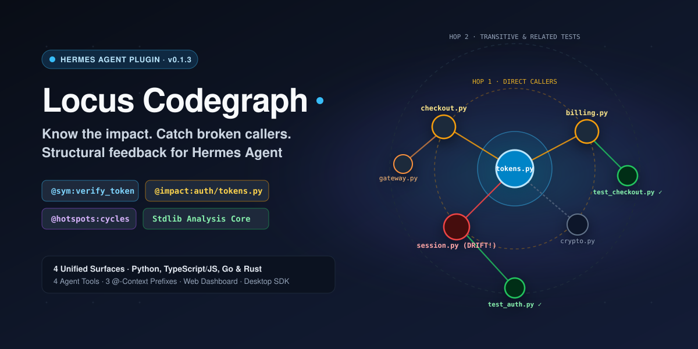
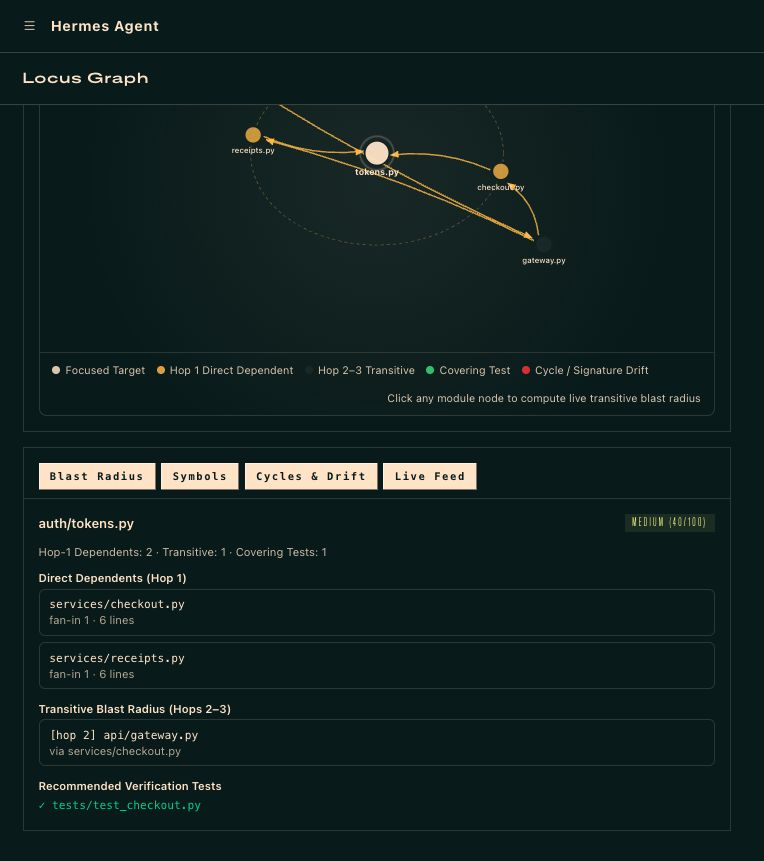

# Locus Codegraph — Catch cross-file breakage while Hermes edits



**Locus Codegraph puts precise caller feedback inside Hermes's edit results.** When a supported Python signature change breaks an indexed caller, the agent receives the caller's file and line, the binding error, and a repair suggestion where one can be checked. A local repository graph also powers agent tools, `@` context references, the Web Dashboard, and Hermes Desktop.

[Watch the 60-second study replay](assets/locus-v015-proof.mp4) · [Captions](assets/locus-v015-proof.srt) · [Current native UI proof](docs/evidence/v015-native-stale-verification.md) · [Verification](docs/verification.md#version-015-candidate)

The video replays one recorded controlled `efbf401` study session: a pre-applied helper edit, model-requested caller repairs, then independent evaluator tests. It is an evidence replay, not a live UI recording or a typical-success claim. [Trace and media provenance](docs/evidence/v015-demo-selected-evidence.json).

**New in 0.2.0: rehearse a refactor before making it.** `@whatif:verify_token(token,*,scope=None)`, or the `locus_rehearse` tool, binds every proven caller against a proposed signature before any file changes and lists what would break and why. For a renamed keyword it returns a caller patch to review, and the same patch now arrives inside the post-edit alert. Checks also reach calls inside the edited file and methods on locally constructed instances. Version 0.2.0 has [its own corpus and host evidence](docs/verification.md#version-020-rehearsal-same-file-and-instance-calls); the install replay, admission, Web/Desktop and model-study records below belong to the 0.1.5 pin.

Version **0.1.5 was the previous private release candidate**. It extends Python resolution to supported module imports, import aliases, and static re-exports; makes the caller inbox actionable; and exposes incomplete scans throughout reports. Current deterministic results are below; video and model-study evidence use the earlier frozen engine. A later local extension also checks class constructors and static/class methods called through an imported class; it has its own corpus evidence and has not been through the install replay, admission, or Web/Desktop checks. The completed paired model study, final-engine corpus reruns, and native Desktop checks have separate provenance.

The analysis engine uses Python's standard library (`ast`, `sqlite3`, and structural parsers). It needs no API key, hosted index, or extra model call. Hermes supplies the web and desktop integration libraries.

## One refactor, a complete feedback loop

Suppose checkout code calls `verify_token(token, audience="checkout")`, and an API route depends on checkout.

1. **See the impact.** `@impact:auth/tokens.py` identifies direct and indirect dependents and suggests related tests.
2. **Rehearse it.** `@whatif:verify_token(token,*,scope=None)` reports, before anything is edited, that the checkout call would break with `unexpected keyword argument 'audience'`, and offers a caller patch for the rename.
3. **Make the change.** Hermes renames the `audience` parameter to `scope`. The total number of parameters stays the same.
4. **Catch a missed caller.** Locus appends a warning to the editing tool's result.

   ```text
   [Locus Signature Drift Alert]
   CRITICAL: verify_token in auth/tokens.py
   -> Update caller services/checkout.py:6: unexpected keyword argument 'audience'
      Review replacing audience= with scope=.
   ```

5. **Repair and verify.** Hermes applies the caller patch carried in the alert, or updates the caller itself, and runs the relevant tests. Locus re-evaluates the tracked mismatch as files are indexed and clears it when the incompatible references are gone.

Locus supplies the evidence and the agent performs the repair. The warning above is abbreviated for illustration.

In a recorded v0.1.4 refactor on Hermes Agent's own code, Locus named all five affected call sites in the result of the first edit, before Hermes searched for callers. Hermes confirmed the locations, repaired the calls, and passed all 26 upstream display tests. [Historical live evidence and replay](docs/verification.md#live-keyword-refactor-on-hermes-agent)

Across 19 selected edits from Hermes Agent, HTTPX, and Requests, the final v0.1.5 engine named **42 of 42 incompatible call instances**, including the module-qualified Requests case, and none of 34 compatible instances. A separate 12-case real-source corpus named **22 of 24** incompatible instances: all 22 cross-file calls, with two same-file misses. It named none of 28 compatible instances. With class-bound calls added, the extended engine named **25 of 26** incompatible instances on four pinned Hermes classes, missing one same-file call, and **16 of 20** in authored class fixtures. The four misses there are documented gaps: two calls through an instance, a dataclass constructor, and a class with an imported base. It named none of 51 compatible instances; the previous engine named none of the 46 breaks. [Class-bound results and limits](docs/verification.md#class-bound-calls-on-the-extended-engine). On version 0.2.0, with calls inside the edited file now labelled, the same corpora read **45 of 45**, **24 of 24** and **16 of 16** incompatible instances named and none of 78 compatible ones. The class groups read **25 of 26** and **18 of 21**; the four misses are a call through `self`, a parameter-typed receiver, a dataclass constructor and a class with an imported base. In an unmodified 17,025-file Hermes checkout, 228,354 of 230,467 statically proven calls bind to their current signatures, 2,112 are uncertain because of argument unpacking, and one is incompatible: a test that expects `TypeError`. [Version 0.2.0 results](docs/verification.md#version-020-rehearsal-same-file-and-instance-calls). These targeted checks measure call binding, not repository-wide accuracy or improved agent success. [Current results and raw evidence](docs/verification.md#version-015-candidate); [preserved v0.1.4 comparison](docs/verification.md#signature-changes-across-three-repositories).

Across **11 complete pairs on four selected refactor tasks**, warning feedback used **32 searches versus 67**; independent checks passed **11/11 with warnings and 10/11 without**. This study used frozen engine `efbf401`; one privacy interruption was excluded from the paired comparison. [All 24 attempts, protocol, and limits](docs/verification.md#paired-model-study-on-the-frozen-engine).

## Install

The plugin requires **Hermes Agent >=0.22.0** and uses Hermes's Python runtime. The standalone engine needs Python 3.10 or later.

The repository remains private during preparation. The Git URL below requires repository access; it is not a public installation or catalog-acceptance claim.

```bash
hermes plugins install https://github.com/atikur/hermes-locus --enable
```

From the root of a Python project, run `hermes locus map` to check the installation without a configured model. Start a fresh Hermes session in that project to use Locus during edits. `/locus reindex` refreshes its graph.

After catalog acceptance, the short form is `hermes plugins install locus-codegraph --enable`. In Hermes Desktop, use the plugin installer or this deep link:

```text
hermes://plugin/install?repo=atikur/hermes-locus&enable=1
```

In the tested Desktop 0.22 build, plugin API discovery and enablement use the
backend's launch profile. A pane installed only in another selected profile can
render while its API returns `Plugin not found`. Install and enable Locus in the
profile that launched the backend as well. This is a host installation limitation,
not evidence that named-profile workspace data is shared.

## Try it

In chat:

```text
Inspect @sym:verify_token and @impact:auth/tokens.py before adding a required audience argument.
```

```text
Review @hotspots:cycles and explain the smallest change that would break a dependency cycle.
```

| Reference | What it adds to the prompt |
| --- | --- |
| `@sym:<name>` | Definition and signature, indexed callers/callees, and a bounded source excerpt |
| `@impact:<file-or-symbol>` | Direct and transitive dependents, suggested tests, risk score, and open drift alerts |
| `@whatif:<symbol>(<new parameters>)` | A rehearsal of that signature change: which proven callers would break and why, and a caller patch for a renamed keyword. Write it without spaces, or quote it |
| `@hotspots:all` | Dependency cycles, highly connected modules, modules without inferred test links, and open drift |
| `@hotspots:cycles`, `@hotspots:drift`, `@hotspots:untested` | A focused subset of the health report |

When a symbol name is ambiguous, use its exact target, such as `@sym:auth/tokens.py::verify_token` or `@impact:auth/tokens.py::verify_token`. Locus returns candidates instead of choosing an arbitrary same-name definition.

The same analysis is available through commands:

```text
/locus
/locus map src/auth
/locus impact auth/tokens.py
/locus symbol verify_token
/locus whatif verify_token(token, *, scope=None)
/locus hotspots
/locus reindex
```

```bash
hermes locus scan
hermes locus map
hermes locus impact auth/tokens.py
hermes locus symbol verify_token
hermes locus whatif "verify_token(token, *, scope=None)"
hermes locus hotspots --json
# Analyze a specific project:
hermes locus map --workspace /path/to/project
```

## Agent tools

The `locus-codegraph` toolset exposes five tools, plus a bundled `locus-navigation` skill. Tools read source and maintain the local index; they do not modify source files.

| Tool | Parameters | Result |
| --- | --- | --- |
| `locus_map` | `scope_prefix?`, `max_files?`, `workspace?` | PageRank-ranked modules, exported signatures, languages, cycles, and drift counts |
| `locus_symbol` | `name`, `workspace?` | Definition, signature, indexed call sites, outgoing calls, and source excerpt |
| `locus_impact` | `target`, `max_depth?`, `workspace?` | Reverse dependency traversal, related test files, and a heuristic 0–100 impact score |
| `locus_rehearse` | `target`, `new_signature`, `workspace?` | Before any edit: proven callers a proposed signature would break, with reasons, and a caller patch for a renamed keyword |
| `locus_hotspots` | `workspace?` | Dependency cycles, high-coupling modules, inferred test gaps, and unresolved drift |

## Web and desktop



*Historical capture from the real Hermes Web Dashboard using the disposable checkout fixture. It predates the v0.1.5 caller inbox.*

- **Web Dashboard:** `/locus-codegraph` opens with caller alerts: every stored location in each displayed alert, binding reasons, available repair suggestions, and copyable repair context. A keyboard-accessible graph, file list, symbol search, and workspace selection provide navigation. The page and `sessions:top` drift banner refresh every five seconds.
- **Hermes Desktop:** the **Locus Codegraph** pane shares the caller inbox and coverage warnings, provides status and command-palette actions, and refreshes through polling and plugin events. It inserts repair context or `@impact:<file>` into a draft for review; it does not send the message. [Actual Desktop 0.22 interaction checks](docs/evidence/v015-native-verification.md) covered eight callers, the complete unsent draft, keyboard navigation, repair, parsing errors, and dismissal.

The inbox shows the newest 20 open alerts with an exact total and the newest 10 closed records. Earlier open alerts appear as displayed ones clear. Closed records include automatic clearance and manual dismissal; neither means tests passed. Check the workspace in copied repair context when switching repositories.

## Analysis depth and limits

| Language | Analysis |
| --- | --- |
| Python (`.py`, `.pyi`) | AST definitions, signatures, imports, and call sites. Checks positional and keyword binding for undecorated functions, class constructors, static/class methods called through the class, and methods on locally constructed instances, across files and inside the edited file. |
| TypeScript / JavaScript | Structural definitions and imports, plus approximate call extraction; call argument counts are not available |
| Go / Rust | Structural definitions and imports; no call-site extraction |

Locus is a navigation and refactoring aid. Its results have these boundaries:

- **Supported Python bindings:** direct imports, module-qualified calls, `import`/`from` aliases, relative imports, common `src`/`lib` layouts, and static re-exports can resolve to indexed undecorated functions. Function-local imports are scoped separately. Binding checks cover renamed keywords, required arguments, and positional-only and keyword-only parameters.
- **Classes:** calling an imported class is checked against its own `__init__`, or a sole same-module base's when it defines none. `Class.method()` is checked for static and class methods, including one inherited from a sole same-module base. This applies to bare top-level classes whose bases are absent, `object`, `ABC`, built-in exceptions, or such classes in the same module.
- **Instances and same-file calls:** a method call is checked when its receiver is a name assigned exactly once from a proven constructor, such as `client = Client(...)` followed by `client.send(...)`. Calls inside the edited file are checked when they provably name that module's own function or class.
- **Repair patches:** for a single renamed keyword, the rehearsal and the post-edit alert include a patch that renames it at the proven call sites. Locus offers the patch; it never applies it.
- **Uncertain calls:** conditional or ambiguous imports, shadowed names, dynamic dispatch, assignment-created function aliases, decorated functions, and unpacked arguments may remain unresolved or require manual review. Receivers whose exact type is not in view are not checked: parameters, `self`, attributes such as `self.client`, reassigned names, and values returned by other calls. Decorated classes (including dataclasses), classes with a metaclass, `__new__`, or an imported base, and rebound or conditionally defined members have no proven calling convention. Locus does not guess a target from a matching name. No alert, and no predicted break in a rehearsal, does not establish compatibility. Runtime tests still check values and behavior.
- **Suggested tests:** the reports' “covering tests” are inferred from dependencies and filename conventions. Locus does not measure execution coverage or run those tests.
- **Risk scores:** the 0–100 score combines dependency counts, inferred test gaps, and drift alerts. It is a prioritization heuristic, not a failure probability.
- **Edit feedback:** hooks respond to supported Hermes editing tools and recognized paths. Locus is not a filesystem watcher; after external editor or shell changes, use `/locus reindex` to refresh the graph.
- **Indexing:** supported source files are bounded by size and file count. Root-level `.gitignore` patterns are supported on a best-effort basis; nested ignore files and negation are not implemented.
- **Incomplete edits:** invalid Python retains the last valid graph and produces an indexing warning. Repair the syntax and reindex before treating that file's graph as current. Parse failures and file-cap warnings persist across page refreshes and appear in analysis reports.
- **Performance:** unchanged files are cached using modification time, size, and SHA-256. An edited file is reparsed, then dependency links and rankings are refreshed. Timings depend on workspace size and hardware; the demo prints measurements for its own small fixture.

## Configuration

Use Hermes Settings or `plugins.entries.locus-codegraph.settings` in your Hermes configuration.

| Setting | Default | Effect |
| --- | --- | --- |
| `auto_index_on_start` | `true` | Incrementally index the active workspace when a session starts |
| `drift_guard` | `true` | Append signature-drift notices to recognized editing-tool results |
| `max_files` | `2500` | Maximum files for session-start scans and `/locus reindex`; set a positive integer |

Web/Desktop rescans reuse the last recorded scan cap, so refreshing a workspace does not silently replace a larger configured scan with the default.

## Development and verification

The standalone engine demo needs only Python >=3.10:

```bash
python3.11 scripts/run_demo.py
python3.11 scripts/run_demo.py --cinematic
```

This fixture exercises indexing, impact, drift detection, and clearance. It simulates edits directly; it is not a recording of an LLM-driven Hermes session.

For a real Hermes session, create a persistent disposable project in an empty directory:

```bash
python3.11 scripts/create_demo_workspace.py ../locus-demo
cd ../locus-demo
python3.11 -m unittest discover -s tests -v
hermes
```

The fixture contains synthetic authentication logic, two direct callers, an API layer, and three baseline tests. Use the prompt in [the submission runbook](docs/submission.md) to demonstrate the edit-feedback-repair loop. A configured Hermes model is needed for the agent session; creating and testing the fixture needs no API key.

Install the test-only dependencies in an isolated environment:

```bash
python3.11 -m venv .venv
.venv/bin/python -m pip install -r requirements-dev.txt
.venv/bin/python -m unittest discover -s tests -v
node --test tests/ui.test.cjs
```

FastAPI and HTTPX are needed to test the dashboard API outside Hermes. The core itself has no third-party runtime dependencies. The Node tests load the shipped bundles with SDK component stubs; they verify UI contracts, not native rendering. Tests that require Hermes's own modules are skipped in standalone mode; run the suite in a configured Hermes environment as well to exercise those integrations.

Before publishing, use the actual Hermes environment to run:

```bash
hermes plugins validate . --install-deps
hermes plugins doctor . --ci
```

See [the submission runbook](docs/submission.md) for the real-session demonstration and evidence checklist.

In one final-engine v0.1.5 trial, a full 17,025-file index took 65.50 seconds from a fresh database and 1.98 seconds cached. A real Hermes one-file patch with caller feedback took 6.76 seconds; a three-file repair took 6.51 seconds. These include host work and are not isolated plugin overhead. The scan used a raised 20,000-file cap. [Exact snapshot, method, limits, and historical measurements](docs/performance.md).

## Verified behavior

The pinned 0.1.5 candidate recorded **123 passing Python checks in Hermes, 10 UI contract checks, and 7 evaluator-validity checks**. Minimum-version Python 3.10.22 passed 120 checks with 3 Hermes-runtime-only skips. The class-bound extension adds seven checks: 130 pass in Hermes, and Python 3.10.22 passes 127 with the same 3 skips. Version 0.2.0 has 146 checks: all pass in Hermes, and Python 3.10.22 passes 143 with the same 3 skips. Actual Web and native Desktop workflows passed on a synthetic fixture, including a [final-engine stale-source follow-up](docs/evidence/v015-native-stale-verification.md).

The [verification record](docs/verification.md#version-015-candidate) separates current confidence-preservation and stale-source fixes from the frozen corpus/model snapshot. Previously indexed files that can no longer be scanned retain explicit stale coverage and affected caller evidence marked **Needs verification**. Final-engine corpus reruns are complete. In the earlier frozen-engine model study, 11 complete pairs produced 10 both-pass outcomes and one warning-on-only pass. Across those pairs, warning-on used 112 file-tool calls versus 169 without the warning. All 24 attempts are preserved, including one privacy interruption excluded from comparison. This four-task study does not establish a general success-rate improvement. [Paired results and limits](docs/verification.md#paired-model-study-on-the-frozen-engine).

[Watch the earlier 77-second model session](https://github.com/atikur/hermes-locus/releases/download/v0.1.2/locus-submission-demo.mp4) · [Download its captions](https://github.com/atikur/hermes-locus/releases/download/v0.1.2/locus-submission-demo.srt)

## Architecture

```text
Workspace source
  → Python AST / structural parsers
  → incremental index + SQLite WAL
  → resolved dependencies + PageRank + cycle detection
  → agent tools / context references / web API / desktop pane

Hermes editing tool
  → editing hooks: reindex and compare contracts
  → tool result: append actionable drift feedback
  → agent repairs callers and runs tests
```

| Path | Responsibility |
| --- | --- |
| `plugin.yaml`, `__init__.py` | Hermes manifest, registration, commands, tools, context providers, and hooks |
| `locus_core/parsers.py`, `indexer.py` | Source extraction, incremental scanning, and dependency linking |
| `locus_core/storage.py` | Profile-scoped SQLite storage |
| `locus_core/graph.py` | Repository maps, symbols, impact, cycles, and visualization data |
| `locus_core/drift.py`, `formatter.py` | Contract comparison and bounded reports |
| `locus_core/rehearsal.py` | Signature rehearsal and caller patches |
| `dashboard/`, `desktop/` | Web and native Hermes interfaces |
| `tests/`, `scripts/run_demo.py` | Automated checks and deterministic engine showcase |

## Privacy and behavior disclosure

- **Reads:** supported source files inside the selected workspace. The scanner rejects filesystem/home/system roots and sensitive credential directories, skips hidden files and build/vendor directories, rejects symlink escapes, skips detected binary content, and limits each source file to 512 KiB. Supported extensions are `.py`, `.pyi`, `.ts`, `.tsx`, `.js`, `.jsx`, `.mjs`, `.cjs`, `.go`, and `.rs`.
- **Stores locally:** file metadata, signatures, short docstring summaries, imports, calls, drift records, and activity metadata in `<HERMES_HOME>/plugin-data/locus-codegraph/locus.db`. Full source files are not stored in the database. Source excerpts are read when requested.
- **Changes context:** explicit `@sym:`, `@impact:`, and `@hotspots:` references expand into reports. With `drift_guard` enabled, recognized editing-tool results may include a drift notice. Those reports and source excerpts become visible to the model configured in Hermes.
- **No external service calls:** Locus's analysis makes no outbound network requests, reads no API credentials, collects no telemetry, and spawns no shell commands or background daemons. Web/Desktop clients communicate with Hermes's API. Locus never modifies workspace source files.

## License

MIT © Atikur Rahman
