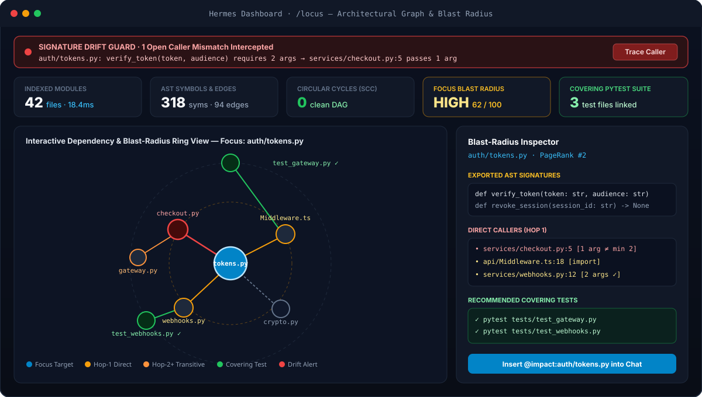

# Locus — Architectural GPS, Blast-Radius Engine & Signature Drift Guard for Hermes Agent


**Locus** gives Hermes Agent live structural awareness of your codebase across **4 unified surfaces** — **Agent Tools & Lifecycle Hooks**, **Inline `@` Context References**, the **Hermes Web Dashboard (`/locus`)**, and **Hermes Desktop (`@hermes/plugin-sdk`)** — powered by a pure Python standard-library AST & SQLite WAL graph engine with **zero third-party runtime dependencies**.

Instead of burning context tokens grepping blindly or silently breaking callers in another module during a multi-file refactor, Hermes can map PageRank architectural hubs in milliseconds, compute transitive blast radius + covering test files *before* editing, and self-heal broken caller signatures *automatically* mid-turn.

---

## Key Capabilities

- **Inline `@` Context References (`@sym:`, `@impact:`, `@hotspots:`)** — Type `@sym:verify_token`, `@impact:auth/tokens.py`, or `@hotspots:cycles` directly in the Hermes CLI, TUI, Web, or Desktop composer with live fuzzy autocomplete and bounded Markdown expansion.
- **Pre-Refactor Transitive Blast Radius (`locus_impact`)** — Reverse-BFS traversal across cross-file imports and call sites reveals **Hop-1 direct dependents**, **Hop-2/3 transitive dependents**, **covering test files** to run, and a `0–100` risk score (`LOW` / `MEDIUM` / `HIGH` / `CRITICAL`).
- **Real-Time Signature Drift Guard (`post_tool_call` + `transform_tool_result`)** — Whenever Hermes edits a file via `patch`, `write_file`, or `edit_file`, Locus re-parses the file in `<5 ms`. If an exported function/method changes required arity or is removed while external callers still invoke the old contract, Locus appends a `[Locus Signature Drift Alert]` directly into the tool result so the agent fixes every caller before finishing its turn — then **auto-resolves** the alert once callers are updated.
- **PageRank Repo Map & Cycle Detector (`locus_map`, `locus_hotspots`)** — 25-iteration PageRank ranks central hub modules first, while Tarjan Strongly Connected Components (`SCC`) pinpoints circular import chains and high-centrality modules lacking test coverage.
- **Multi-Language Zero-Dependency Indexer** — Deep `ast` symbol/signature/arity/call extraction for **Python**, plus fast structural lexers for **TypeScript / JavaScript**, **Go**, and **Rust**, backed by incremental `mtime` + `SHA-256` caching in SQLite WAL.
- **Interactive Web Dashboard & Native Desktop Pane** — Explore dependency and blast-radius rings visually at `/locus` in the Web Dashboard or inside the native `Locus Graph` right-side pane in Hermes Desktop, with one-click `@impact:<file>` composer insertion.

---

## Installation

### From the Hermes Plugin Catalog

```bash
hermes plugins install locus
```

### Direct from GitHub

```bash
hermes plugins install https://github.com/atikur/hermes-locus
```

### In Hermes Desktop

Open Command Palette or launch via deep link:

```text
hermes://plugin/install?repo=atikur/hermes-locus&enable=1
```

---

## Quickstart

### 1. Inline `@` Context References in Chat

Reference symbols, blast radius, or architectural health directly in any prompt — Locus expands the exact AST neighborhood inline without wasting tool turns:

```text
Refactor @sym:verify_token to require a tenant audience — check @impact:auth/tokens.py first.
```

```text
Audit circular dependencies in @hotspots:cycles and propose the cleanest seam to break them.
```

| Prefix | Autocomplete Source | Injected Prompt Context |
| :--- | :--- | :--- |
| `@sym:<name>` | Live fuzzy search over workspace classes, functions, methods & interfaces | Exact `file:line`, full signature, incoming call sites with arg counts, outgoing callees, and bounded source snippet |
| `@impact:<target>` | Ranked workspace module paths and exported symbol names | Risk score (`0–100`), Hop-1 direct callers, Hop-2/3 transitive dependents, open drift alerts, and covering test files |
| `@hotspots:<scope>` | `all`, `cycles`, `drift`, `untested` | Tarjan circular import chains, high-coupling hub modules, untested core modules, and unresolved signature drift alerts |

### 2. Slash Command (`/locus`) & CLI (`hermes locus`)

Inside any Hermes chat session:

```text
/locus                  # Interactive menu (Status, Repo Map, Hotspots, Force Re-Index)
/locus map src/auth     # PageRank architectural map scoped to src/auth
/locus impact tokens.py # Pre-refactor blast radius & covering tests
/locus symbol settle    # Definition, callers, callees & snippet
/locus hotspots         # Cycles, god-modules, untested hubs & open drift
```

From your terminal:

```bash
hermes locus scan
hermes locus map
hermes locus impact auth/tokens.py
hermes locus symbol verify_token
hermes locus hotspots --json
```

---

## Agent Tools (`toolset: locus`)

Locus registers four deterministic, read-only tools for autonomous planning and safe refactoring (plus the bundled `locus-navigation` skill):

| Tool | Parameters | Purpose |
| :--- | :--- | :--- |
| `locus_map` | `scope_prefix?`, `max_files?`, `workspace?` | PageRank-ranked repository map with exported class/function signatures, language breakdown, cycle count, and drift count. |
| `locus_symbol` | `name` *(required)*, `workspace?` | Exact AST symbol definition (`path:line`), parameter arity, incoming workspace callers, outgoing callees, and bounded code excerpt. |
| `locus_impact` | `target` *(required)*, `max_depth?`, `workspace?` | Reverse dependency BFS returning Hop-1 direct dependents, Hop-2+ transitive dependents, covering test files, and `0–100` risk level. |
| `locus_hotspots` | `workspace?` | Codebase health audit surfacing Tarjan circular import cycles, high-coupling hub modules, untested central files, and open drift alerts. |

---

## Real-Time Signature Drift Guard

When an AI agent adds a required parameter or deletes a helper function, callers in other files often break silently. Locus closes this loop automatically using `post_tool_call` and `transform_tool_result`:

1. **Edit Detected**: Hermes runs `patch` on `auth/tokens.py`, changing `def verify_token(token: str)` to `def verify_token(token: str, audience: str)`.
2. **Sub-5ms Incremental Diff**: `post_tool_call` re-indexes `auth/tokens.py` and compares exported symbol contracts against existing external call edges in SQLite.
3. **Inline Feedback Injection**: `transform_tool_result` preserves the original JSON/text tool payload and appends an actionable alert before the model takes its next step:
   ```text
   [Locus Signature Drift Alert]
   Your edit changed or removed exported symbol contract(s) with existing external callers:
   - CRITICAL: `verify_token` in `auth/tokens.py` (`def verify_token(token: str) -> bool` -> `def verify_token(token: str, audience: str) -> bool`)
     -> Update caller `services/checkout.py:6` (`settle_order`, passes 1 arg(s))
   Inspect and update the affected call sites above before concluding your task.
   ```
4. **Self-Healing Auto-Resolution**: Once Hermes updates `services/checkout.py` to pass both arguments, Locus re-indexes the caller file and automatically marks the drift alert resolved (`0` open alerts).

---

## Visual Web Dashboard & Hermes Desktop UI



### Web Dashboard (`/locus` + `sessions:top` Slot)
- **Interactive Radial Dependency & Blast-Radius SVG Graph**: Click any module node to focus it at the center of concentric **Hop-1 Direct** and **Hop-2+ Transitive** blast rings, with covering test files highlighted in green and drifted callers in red.
- **Live Session Drift Banner (`sessions:top`)**: Surfaces unresolved signature drift alerts directly at the top of active Hermes Dashboard sessions with one-click trace and resolution.

### Native Hermes Desktop (`desktop/plugin.js`)
- Built purely against `@hermes/plugin-sdk` and `react/jsx-runtime` (zero external npm bundles, 100% theme-variable adaptive).
- Registers the right-side **Locus Graph** panel, a live bottom status-bar indicator (`Locus: <N> files` / `Locus: <N> drift!`), Command Palette actions, real-time push refresh via `plugin.locus.graph.updated`, and one-click **`@impact:<file>`** / **`@hotspots:all`** insertion directly into the chat composer (`host.composer.insertText`).

---

## Configuration

Configure via Hermes Settings UI or under `plugins.config.locus` in `~/.hermes/config.yaml`:

| Setting | Type | Default | Description |
| :--- | :--- | :--- | :--- |
| `auto_index_on_start` | `boolean` | `true` | Incrementally index the active workspace when a Hermes session starts (`mtime` + `SHA-256` cached). |
| `drift_guard` | `boolean` | `true` | Append `[Locus Signature Drift Alert]` warnings to file-editing tool results when external callers break. |
| `max_files` | `integer` | `2500` | Maximum workspace source files scanned per indexing pass (`50–20000`). |

---

## Run the `<60s` Live Showcase & Test Suite

```bash
# Instant end-to-end terminal showcase (<0.2s)
python3 scripts/run_demo.py

# Paced showcase for screen recording (<60s)
python3 scripts/run_demo.py --cinematic

# Full unit & integration test suite
python3 -m unittest discover -s tests -v

# Official Hermes admission & doctor checks
hermes plugins validate .
hermes plugins doctor . --ci
```

---

## Architecture

```text
hermes-locus/
├── plugin.yaml                      # Manifest v2 (tools, hooks, config_schema, requires_hermes)
├── __init__.py                      # Tools, @sym/@impact/@hotspots, drift hooks, /locus & CLI
├── locus_core/                      # Pure-stdlib graph engine (zero external dependencies)
│   ├── storage.py                   # Profile-scoped SQLite WAL via plugins.plugin_storage.plugin_db
│   ├── parsers.py                   # Python AST + TypeScript/JS, Go, and Rust structural lexers
│   ├── indexer.py                   # Incremental mtime+SHA256 scanner (.gitignore & symlink safe)
│   ├── graph.py                     # PageRank, reverse-BFS blast radius, Tarjan SCC, SVG layout
│   ├── drift.py                     # Pre/post edit signature arity & symbol removal comparator
│   └── formatter.py                 # Token-budgeted Markdown & JSON-preserving drift injection
├── skills/locus-navigation/SKILL.md # Bundled read-only architectural refactoring workflow skill
├── dashboard/                       # Hermes Web Dashboard tab (/locus) + FastAPI plugin_api.py
├── desktop/plugin.js                # Native Hermes Desktop @hermes/plugin-sdk pane & status chip
├── scripts/run_demo.py              # Self-contained <60s live terminal showcase
└── tests/                           # Comprehensive unit, FastAPI, hook, and @-reference tests
```

---

## Security, Privacy & Behavior Disclosure (Catalog Rule 13)

- **Local Workspace Source Reads**: Locus reads source code files (`.py`, `.pyi`, `.ts`, `.tsx`, `.js`, `.jsx`, `.mjs`, `.cjs`, `.go`, `.rs`) inside the active session workspace (or a user-specified `--workspace` directory) to extract AST symbols, imports, and call edges.
- **Strict Path, Symlink & Credential Guards**: The scanner honors `.gitignore`, refuses home-directory root or hidden dot-directory roots, skips all hidden dot-files and dot-directories (`.env`, `.git`, `.ssh`, `.aws`, `.gnupg`, `.hermes`, etc.), skips build/vendor trees (`node_modules`, `.venv`, `target`, `dist`), enforces `realpath` containment so symlinks resolving outside the workspace root are never followed, skips binary files (`NUL`-byte check), and caps individual file reads at `512 KiB`.
- **Local Profile-Scoped Storage Only**: Structural metadata (file hashes, symbol signatures, import/call edges, and drift records — never raw full file contents) is stored locally in `<HERMES_HOME>/plugin-data/locus/locus.db` via `plugins.plugin_storage.plugin_db("locus", "locus.db")`.
- **Tool Result Augmentation**: When `drift_guard` is enabled (default `true`), `transform_tool_result` appends a `[Locus Signature Drift Alert]` notice to the output of file-mutating tools (`write_file`, `patch`, `edit_file`, etc.) only when an edit breaks known external workspace callers.
- **Zero Network, Zero Credentials, Zero Shell Execution**: Locus makes **no external network requests**, collects **no telemetry**, reads **no API keys or `.env` secrets**, spawns **no shell subprocesses**, runs **no background daemons**, and installs **zero third-party Python or npm runtime packages**.

---

## License

MIT © Atikur Rahman
